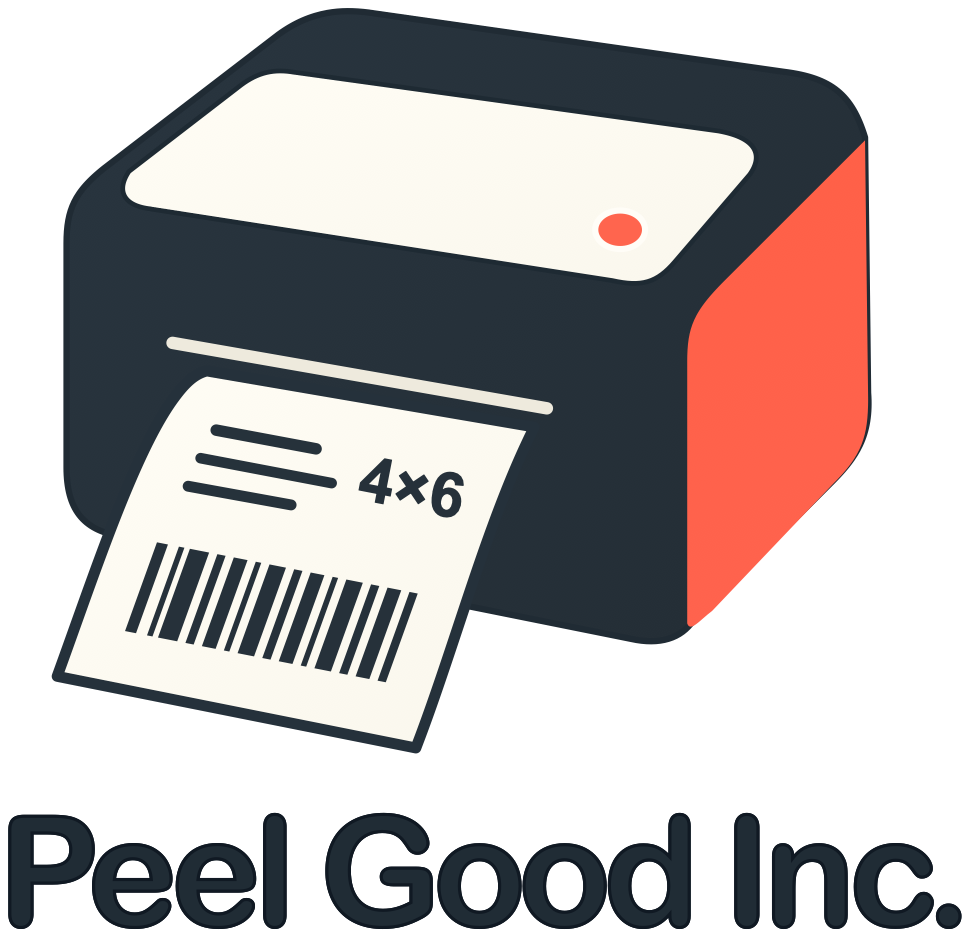
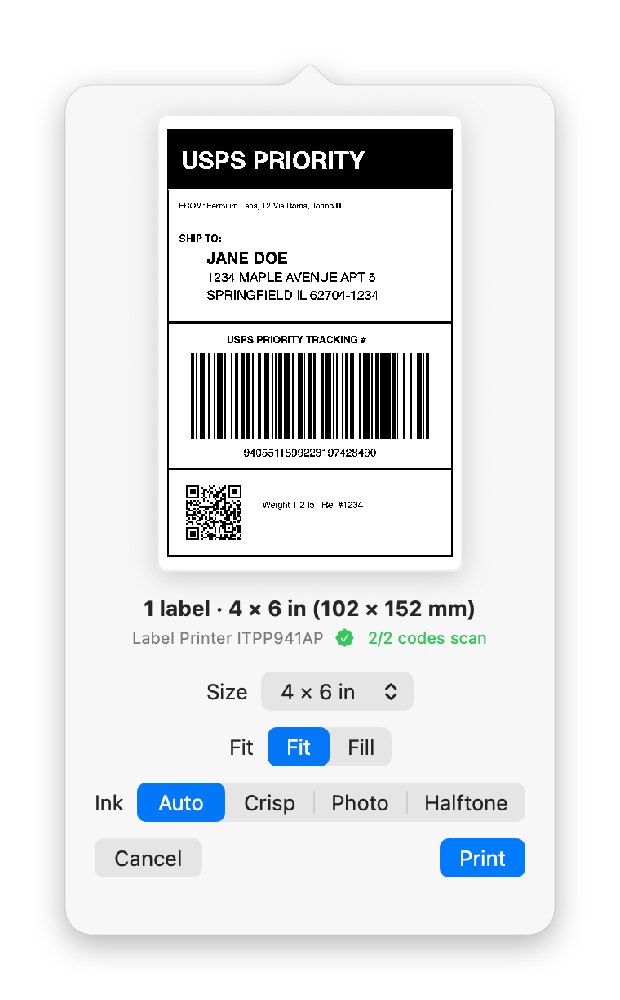
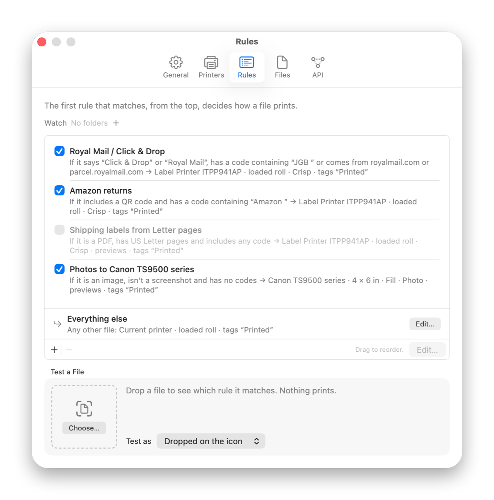
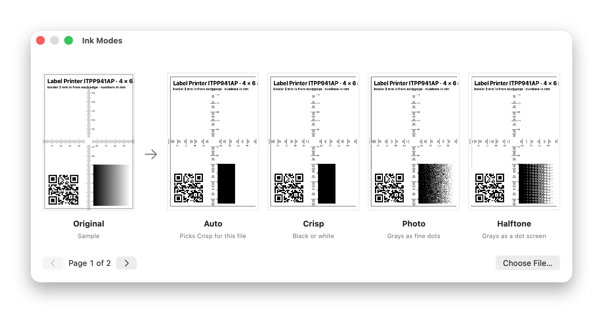

<p align="center">
  <picture>
    <source media="(prefers-color-scheme: dark)" srcset="docs/brand/logo-dark.png">
    
  </picture>
</p>

A small, simple, delightful Mac menu bar app that prints your labels instantly. Drop a PDF, PNG or any other image on it and it prints, with advanced features for automation when you need them.

<p align="center">
  <picture>
    <source media="(prefers-color-scheme: dark)" srcset="docs/screenshots/popover-review-dark.png">
    
  </picture>
</p>

Drop a PDF, screenshot, image or SVG on the parcel icon in the menu bar. Peel Good Inc. centers it, rotates it, scales it and prints it just the way you want.

We're a small family-run business. We got tired of printing all our shipping labels by hand and getting confused about which ones we'd already printed, so we made this.

## Features

- Automatically identifies barcodes, QR codes and DataMatrix codes, and lines them up with the exact dots your printer can print.
- Supports common label sizes such as 4 × 6, 4 × 8, 4 × 4, 4 × 3, 4 × 2, 3 × 5, 3 × 3, 3 × 2, 2.5 × 1.5, 2.25 × 2.25, 2.25 × 1.25 and 2 × 2 in, plus custom sizes.
- Watches a folder for new files.
- Supports advanced rules to identify each label and route it to the right printer with the right settings.
- After printing, it can tag the file in Finder, rename it, move it or put it in the Trash, so there's no confusion about which labels have been printed and which haven't.
- A native Mac app: it works from the Share menu, Services, Open With, the clipboard and, of course, the menu bar.

<p align="center">
  <picture>
    <source media="(prefers-color-scheme: dark)" srcset="docs/screenshots/settings-rules-dark.png">
    
  </picture>
</p>

Thermal label printers can only print in black and white. Unfortunately, documents often aren't formatted for thermal labels, so Peel Good Inc. automatically converts them to black and white, using either a sharp conversion or dithering.

<p align="center">
  <picture>
    <source media="(prefers-color-scheme: dark)" srcset="docs/screenshots/ink-modes-dark.png">
    
  </picture>
</p>

## Install

```sh
brew trust fermium/tap
brew install --cask fermium/tap/peel-good-inc
```

Or download the DMG from [Releases](https://github.com/fermium/peel-good-inc/releases).

Please note the app is not signed by Apple (yet). The Homebrew cask clears the quarantine flag for you automatically. If you use the DMG, Control-click the app and choose Open the first time.

The app requires macOS 15 or later. It has been tested on a MUNBYN ITPP941AP printer, and it should work with any label printer that macOS can print to over AirPrint or a CUPS driver. Keep in mind, though, that CUPS drivers for thermal printers are utterly broken on the Mac.

## Privacy

This app doesn't send any user data. The HTTP API and the MCP server for AI assistants are off by default, and when you turn them on they only accept connections from your own Mac, authenticated with a token. There are no ads, no tracking, nothing of the sort.

## HTTP API and MCP

Other apps, scripts and AI assistants can print labels too. Turn on the HTTP API, the MCP server, or both in Settings → API. They're off until you do, they only answer on your own Mac, and they need the token saved in `~/Library/Application Support/Peel Good/token`. Labels they send are printed the same way as a file you drop on the icon.

The HTTP API prints files you send to it:

```sh
curl -H "Authorization: Bearer $(cat ~/Library/Application\ Support/Peel\ Good/token)" \
  -F file=@label.pdf http://127.0.0.1:47311/v1/print
```

Its docs are at http://127.0.0.1:47311/ while it's on.

The MCP server lets an assistant like Claude list printers, preview labels and print them. If you want it to print files from your Mac or change settings and rules, there are two extra switches for that in Settings → API. To add it to Claude Code:

```sh
claude mcp add --transport http peel-good http://127.0.0.1:47311/mcp \
  --header "Authorization: Bearer $(cat ~/Library/Application\ Support/Peel\ Good/token)"
```

Settings → API also has the setup for Claude Desktop, ready to copy.

## Build from source

```sh
swift build
swift test
./scripts/make-app.sh
open "build/Peel Good Inc.app"
```

The same pipeline is a command-line tool, `labelize` (or `peel` for short). Homebrew installs it with its man page and completions; otherwise use Settings > CLI > Install Command.

```sh
labelize print ~/Downloads/order-1234-label.pdf    # your label printer, the app's settings
labelize preview return-code.png --size 4x4        # label PDF and PNGs, nothing printed
labelize print label.pdf --dry-run --json          # what would be sent, for scripts
labelize doctor                                    # printers, CUPS, the app and its API
labelize help print                                # every option, with examples
```

The old flag-only form (`labelize label.pdf --size 4x6 --print`) still works. In a checkout, use `swift run labelize …`.

`LabelKit` holds the label pipeline and `LabelizeCLI` describes the command line once for help, completions, the man page and Settings > CLI. The app is in `Sources/LabelizeApp`, the release process is in [RELEASING.md](RELEASING.md), and `./scripts/screenshots.sh` renders the screenshots above.

## License

MIT © 2026 Fermium Ltd. The name is a nod to Gorillaz.
