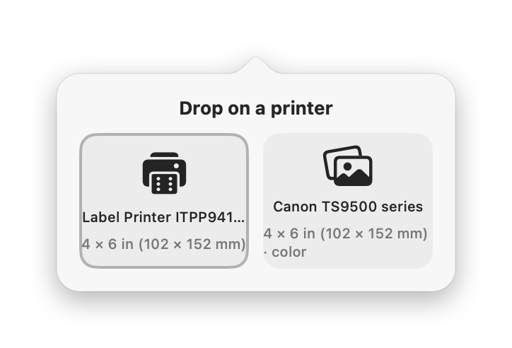
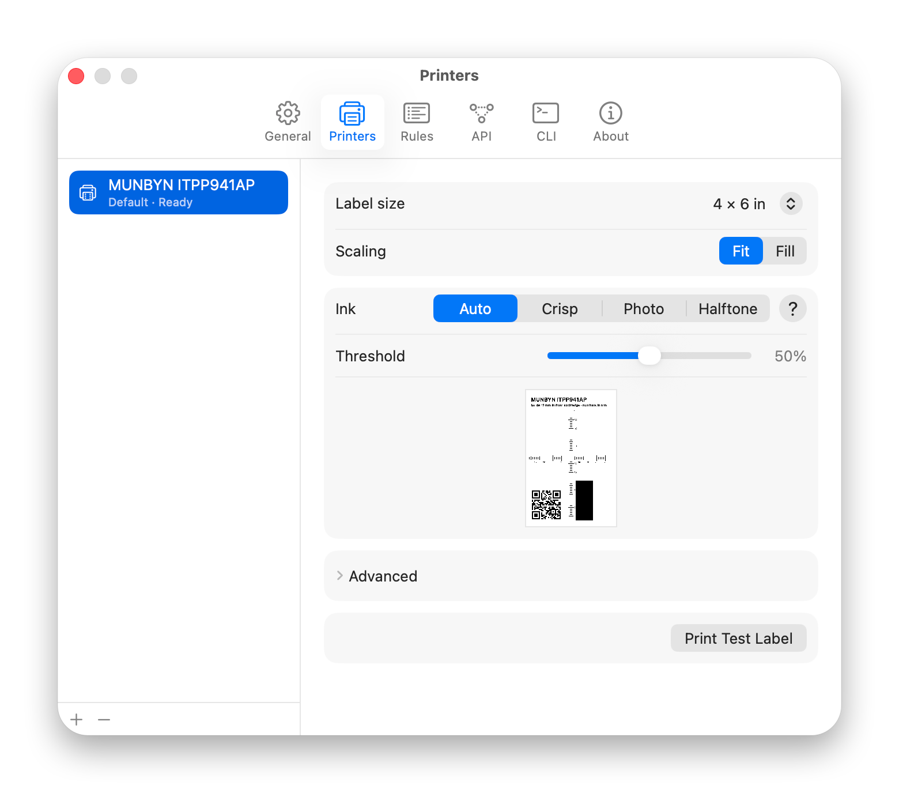
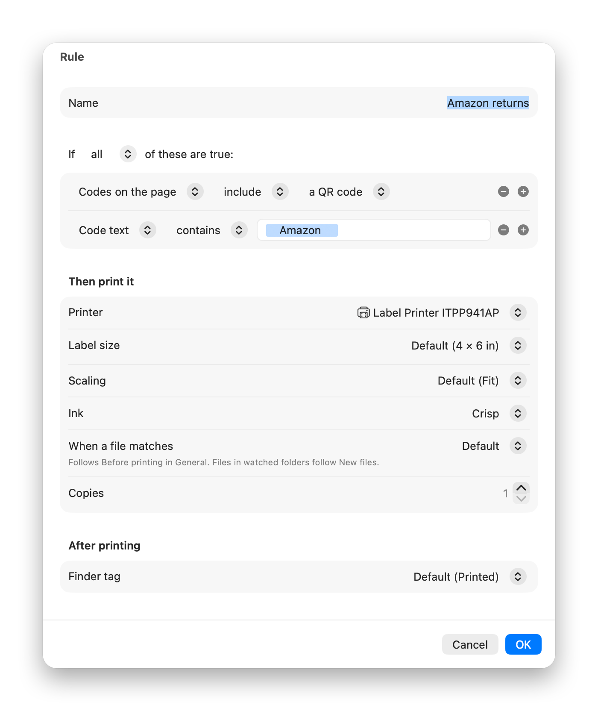
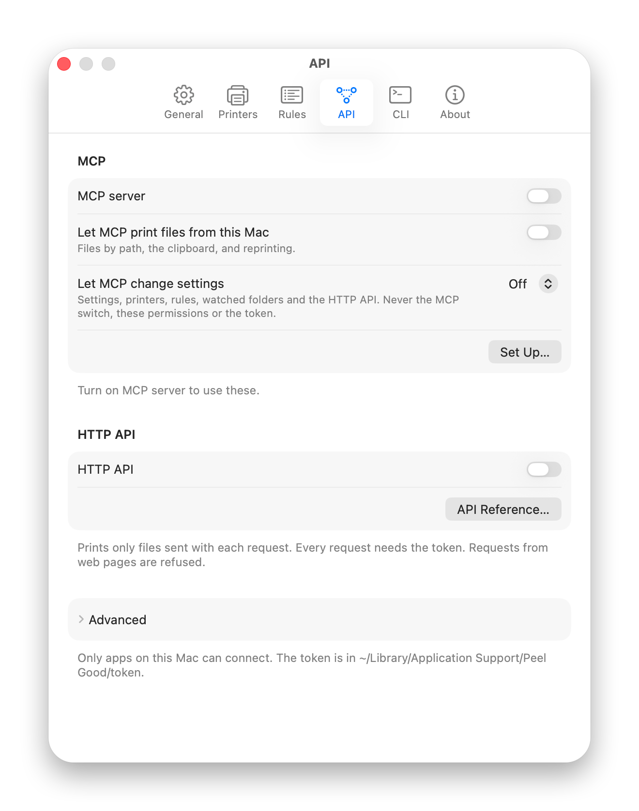
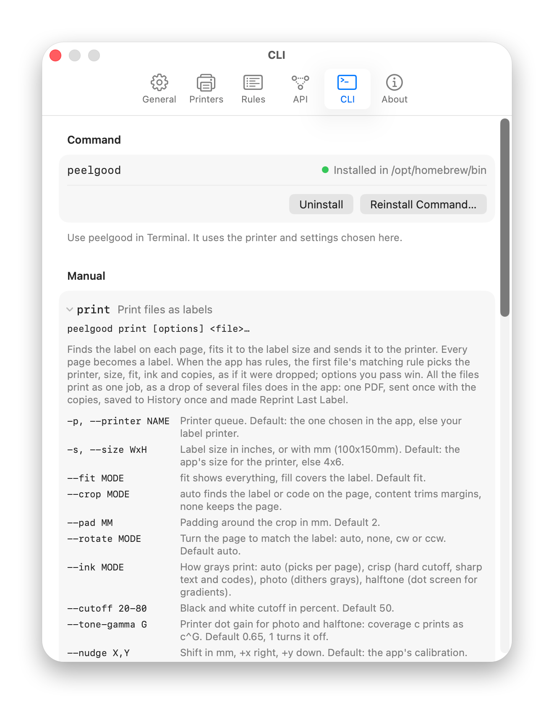

<p align="center">
  <picture>
    <source media="(prefers-color-scheme: dark)" srcset="docs/brand/logo-dark.png">
    
  </picture>
</p>

A small, simple, delightful Mac menu bar app that prints your labels instantly. Drop a PDF/PNG/SVG/etc in the top bar or use the rules to automatically print from a watched folder and route to any printer, including Zebra printers.

<p align="center">
  <picture>
    <source media="(prefers-color-scheme: dark)" srcset="docs/screenshots/popover-review-dark.png">
    
  </picture>
  <picture>
    <source media="(prefers-color-scheme: dark)" srcset="docs/screenshots/popover-dropzones-dark.png">
    
  </picture>
</p>

## Features

- Finds barcodes, QR codes and DataMatrix codes and lines them up with the exact dots in your printhead.
- Extensive rule system to automatically identify documents and send them to the right printer.
- MCP Server to use the printer through AI clients as well as use AI to automatically configure and test the app.
- Common label sizes: 4 × 6, 4 × 8, 4 × 4, 4 × 3, 4 × 2, 3 × 5, 3 × 3, 3 × 2, 2.5 × 1.5, 2.25 × 2.25, 2.25 × 1.25 and 2 × 2 in, metric rolls such as 100 × 150 mm, and custom sizes.
- Prints to Zebra printers on your network in ZPL, no driver needed.
- Watches a folder for new files.
- After printing it can tag the file in Finder, rename it, move it or put it in the Trash, so you always know which labels are done.
- Native Mac app: Share menu, Services, Open With, the clipboard and the menu bar.
- Thermal printers only print black and white, and most documents aren't made for that. *Peel Good Inc.* converts them using multiple algorithms (sharp, dithering, halftone).

<p align="center">
  <picture>
    <source media="(prefers-color-scheme: dark)" srcset="docs/screenshots/settings-printers-dark.png">
    
  </picture>
</p>

<p align="center">
  <picture>
    <source media="(prefers-color-scheme: dark)" srcset="docs/screenshots/ink-modes-dark.png">
    
  </picture>
</p>

## Rules

A rule is one sentence: when a file matches these conditions, print it on this printer at this size. Rules are checked from the top; the first match wins. Anything else goes to the default printer.

Conditions: source website, file name, file type, folder, how it arrived (drop, clipboard, Finder, watched folder, another app), page size, number of pages, codes on the page, code text.

A rule sets the printer, label size, scaling, ink, copies, whether to print, preview or ask first, and a Finder tag after printing.

Templates for Amazon returns, Royal Mail Click & Drop and shipping labels on Letter pages. Test a File in Settings → Rules shows which rule a file matches without printing.

<p align="center">
  <picture>
    <source media="(prefers-color-scheme: dark)" srcset="docs/screenshots/settings-rules-dark.png">
    
  </picture>
</p>

<p align="center">
  <picture>
    <source media="(prefers-color-scheme: dark)" srcset="docs/screenshots/settings-rule-editor-dark.png">
    
  </picture>
</p>

## Zebra printers

macOS ships drivers for Zebra printers through CUPS, but they suffer from long-documented bugs and limitations in the way they render labels ([apple/cups#5092](https://github.com/apple/cups/issues/5092), [apple/cups#6113](https://github.com/apple/cups/issues/6113)), which make them close to unusable for barcodes. *Peel Good Inc.* skips them and sends each label to the printer as ZPL, dot for dot, over the network.

When it starts, *Peel Good Inc.* looks for Zebra printers on your network. Deny the permission pop-up to block this. Printers can also be added by address, and Settings → Printers has options such as:

- label size, scaling and ink
- a position offset, which can be moved onto the printer to be used by every app
- live status: head open, out of labels, paused

Tested on a Zebra GX420t. USB Zebras aren't supported yet.

## Install

```sh
brew trust fermium/tap
brew install --cask fermium/tap/peel-good-inc
```

Or download the DMG from [Releases](https://github.com/fermium/peel-good-inc/releases).

The app isn't signed by Apple (yet). The Homebrew cask clears the quarantine flag for you. With the DMG, Control-click the app and choose Open the first time.

Needs macOS 15 or later. Tested on a MUNBYN ITPP941AP; it should work with any label printer macOS can print to over AirPrint or a CUPS driver.

Keep in mind that CUPS drivers for thermal printers are utterly broken on the Mac.

## Privacy

No user data leaves your Mac. No ads, no tracking, no analytics.

The HTTP API and MCP server are off by default and, when on, only accept token-authenticated connections from your own Mac.

## HTTP API and MCP

<p align="center">
  <picture>
    <source media="(prefers-color-scheme: dark)" srcset="docs/screenshots/settings-api-dark.png">
    
  </picture>
</p>

Turn either on in Settings → API. Both listen on 127.0.0.1:47311 and use the token in `~/Library/Application Support/Peel Good/token`.

Jobs follow your rules, same as dropping a file in the top bar.

HTTP: upload a file, it prints. Docs at http://127.0.0.1:47311/.

```sh
curl -H "Authorization: Bearer $(cat ~/Library/Application\ Support/Peel\ Good/token)" \
  -F file=@label.pdf http://127.0.0.1:47311/v1/print
```

MCP: printers, sizes, preview, print, jobs, settings and rules. Reading local files and changing settings each have their own switch.

```sh
claude mcp add --transport http peel-good http://127.0.0.1:47311/mcp \
  --header "Authorization: Bearer $(cat ~/Library/Application\ Support/Peel\ Good/token)"
```

For Claude Desktop, copy the config from Settings → API.

## Command line

```
peelgood print [options] file...
peelgood preview [options] file...
peelgood doctor
peelgood help [command]
```

```
print      Print to the default label printer.
preview    Write the label PDF and PNGs. Nothing is printed.
doctor     Check printers, CUPS and the app.
help       Show options for a command.

--size WxH     Label size in inches or mm, e.g. 4x6 or 100x150mm.
--dry-run      Show what would be sent. Nothing is printed.
--json         Machine-readable output.
```

Uses the app's printers, settings and rules. Installed by Homebrew with its man page and completions, or from Settings → CLI. See `man peelgood`.

<p align="center">
  <picture>
    <source media="(prefers-color-scheme: dark)" srcset="docs/screenshots/settings-cli-dark.png">
    
  </picture>
</p>

## Build from source

```bash
swift build
swift test
./scripts/make-app.sh
open "build/Peel Good Inc.app"
```

## License

MIT © 2026 Fermium Ltd. The name is a nod to Gorillaz.
