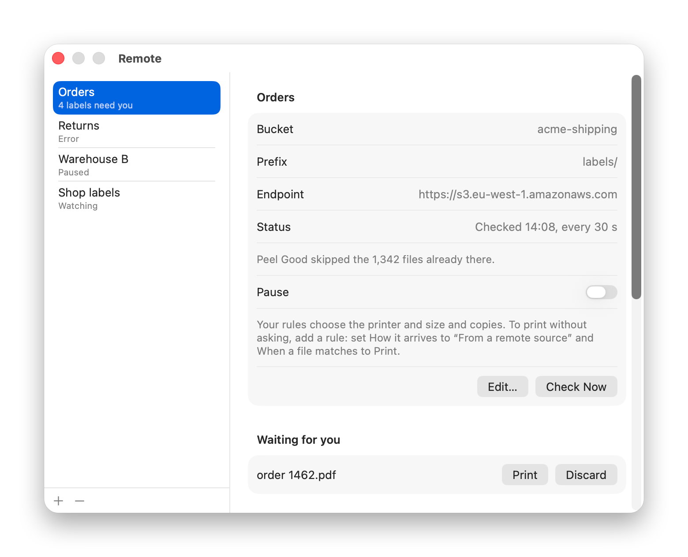
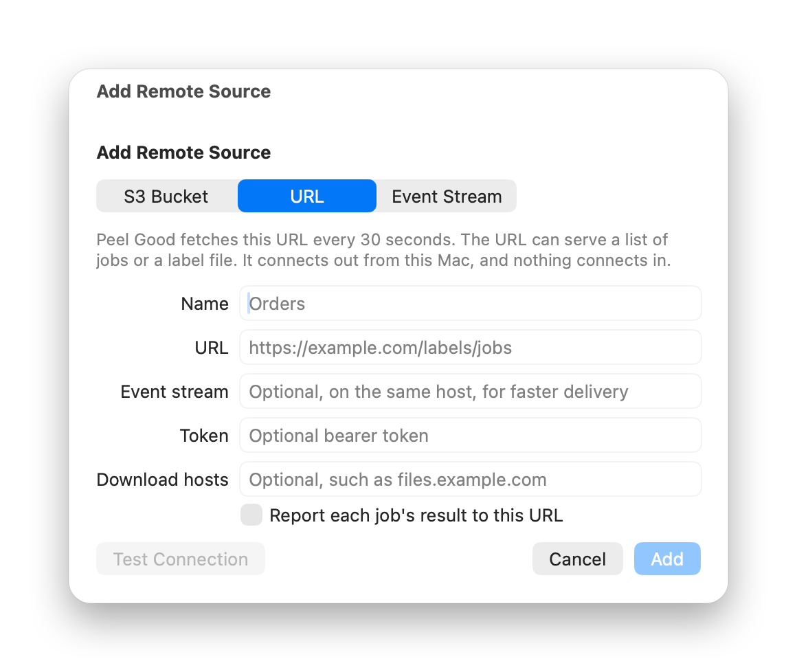
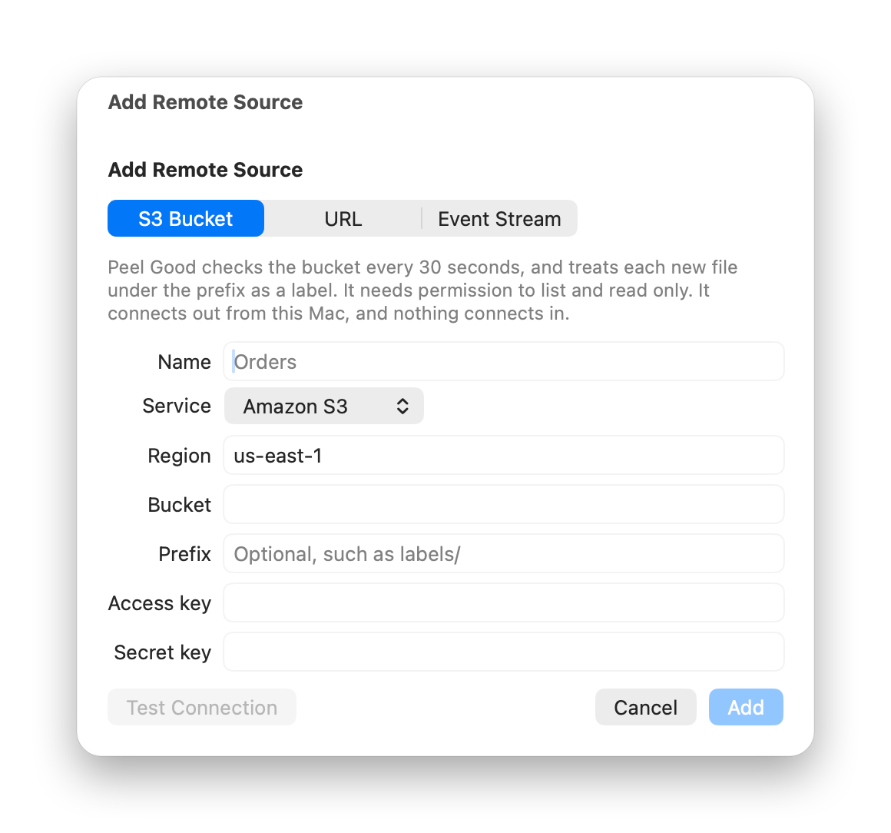
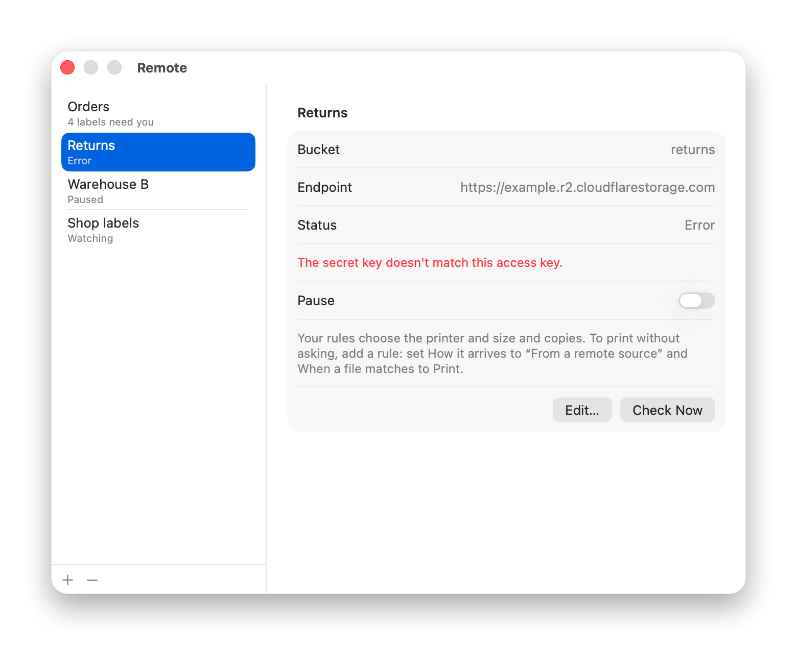

# Remote print jobs

*Peel Good Inc.* can fetch print jobs from an HTTPS URL, follow a Server-Sent Events stream, or watch an S3-compatible bucket.

Your Mac makes every connection. Nothing listens on the internet, and you don't open any ports. Add and edit sources in **Settings → Remote**.

<p align="center">
  <picture>
    <source media="(prefers-color-scheme: dark)" srcset="screenshots/settings-remote-orders-dark.png">
    
  </picture>
</p>

New remote jobs ask before printing. To print them automatically, add a rule in **Settings → Rules**: set **How it arrives** to **From a remote source** and **When a file matches** to **Print**.

Two settings change this. **New files** under **Settings → Rules → Watched Folders** covers remote jobs too, so setting it to **Print** prints them with no rule. If **Settings → General → Before printing** is **Show preview**, jobs wait under **Waiting for you** until you click **Print**. Remote jobs never open a preview.

## Jobs

URLs and streams deliver jobs as JSON:

```json
{
  "id": "order-1459",
  "url": "https://example.com/labels/1459.pdf",
  "name": "order-1459.pdf",
  "sha256": "9f86d081884c7d659a2feaa0c55ad015a3bf4f1b2b0b822cd15d6c15b0f00a08",
  "copies": 2
}
```

| Field | Description |
|---|---|
| `id` | Required string. 1 to 256 characters from `A-Z`, `a-z`, `0-9`, `-`, `_` and `.`. Case sensitive. Peel Good prints each ID once per source. |
| `url` | Absolute file URL, on your source's host or a host under **Download hosts**. Use this or `content_base64`. |
| `content_base64` | The file itself, up to 1 MB. |
| `name` | Optional. The file name your rules see, made safe for disk. Defaults to the last part of `url`, or the `id`. |
| `sha256` | Optional hex SHA-256. The job fails if the file doesn't match. |
| `copies` | Optional. 1 to 100. Leave it out to use your rule's copies. |

Peel Good skips any job that has an invalid field, and shows a count on the source in **Settings → Remote**.

### Limits

Peel Good prints PDF, PNG and JPEG files up to 25 MB. It reads the file's bytes to decide the type, and fails anything else, including SVG and raw ZPL.

Each source can print 30 labels in any 10 minutes (pages × copies, including a rule's copies). A job over that limit waits in **Held** until you click **Print**, **Print All** or **Discard**. At 500 held jobs, the source pauses and notifies you.

## HTTPS URLs

Peel Good fetches your URL every 30 seconds, and again when the network returns or the Mac wakes.

<p align="center">
  <picture>
    <source media="(prefers-color-scheme: dark)" srcset="screenshots/settings-add-remote-url-dark.png">
    
  </picture>
</p>

```http
GET /labels/jobs HTTP/1.1
Host: shop.example.com
Authorization: Bearer <token>
If-None-Match: "3a8f-5c21"
```

Answer using a jobs list up to 5 MB. Send `{"jobs": []}` when there's nothing to print.

```json
{
  "jobs": [
    {
      "id": "order-1459",
      "url": "https://shop.example.com/labels/1459.pdf"
    }
  ]
}
```

Or serve a PDF, PNG or JPEG directly, with no list. Peel Good prints each new file once, and tells files apart by `ETag`, or by SHA-256 without one.

Peel Good skips whatever's in its first reply, so old jobs don't print.

URLs need `https://`. Plain `http://` only works for `127.0.0.1` and `localhost`, and a URL can't contain a username or password.

If you set a token, Peel Good sends `Authorization: Bearer <token>` to your URL's scheme, host and port, and nowhere else. The token stays in the macOS Keychain. On unsigned builds, macOS asks you to allow access after each update, and the source waits for your answer.

Send an `ETag` up to 1,024 bytes, and Peel Good sends `If-None-Match`. Answer `304` when nothing changed.

### Download hosts

To serve files from another host, such as a CDN or signed storage links, add it under **Download hosts**. This also covers redirects to that host.

Peel Good matches the exact host name, and requires HTTPS. It refuses a download host that resolves to this Mac, a private network or a cloud metadata address: loopback, `169.254.0.0/16`, RFC 1918, `100.64.0.0/10`, `fc00::/7` and `fe80::/10`.

## Server-Sent Events (optional)

A [Server-Sent Events](https://html.spec.whatwg.org/multipage/server-sent-events.html) stream delivers jobs right away. Use it beside a URL, on the same host and port, or on its own.

```http
GET /labels/events HTTP/1.1
Host: shop.example.com
Accept: text/event-stream
Last-Event-ID: 42
Authorization: Bearer <token>
```

```text
: connected

event: label
id: 43
data: {"id": "order-1460", "url": "https://shop.example.com/labels/1460.pdf"}

: keepalive
```

Send `Content-Type: text/event-stream`, a comment line as soon as Peel Good connects, and another at least every 30 seconds. Peel Good can't tell the stream is open until the first bytes arrive, and reconnects after 90 seconds of silence.

Each `event: label` holds one job in `data:`, up to 2 MB. Peel Good ignores other event types, and skips a label event over 2 MB.

Peel Good reconnects after 1 second, doubling up to 5 minutes, and sends the last `id` as `Last-Event-ID`. Replay what it missed from there, because a stream alone can't catch up any other way. Don't send old jobs when that header is missing, because a stream has no first reply to skip.

## Status codes

Your URL and stream should answer using these codes:

| Code | Meaning | What Peel Good does |
|---|---|---|
| `2xx` | Here are the jobs, or the stream | Prints what's new. A reply it can't read counts as "anything else". |
| `304` | Nothing new | Checks again in 30 seconds |
| `401`, `403` | Bad or missing token | Shows **Error**, and retries in 15 minutes |
| `404` | Wrong address | Shows **Error**, and retries in 15 minutes |
| `429`, `503` | Busy | Waits for `Retry-After` in whole seconds, up to 1 hour, or 60 seconds without it |
| Anything else | Problem | Shows **Error**, and retries after growing waits, up to about 5 minutes |

On a file download, a `404` or `410` moves the job to **Failed**, and any other error retries at the next check.

## Reporting results

Turn on **Report each job's result to this URL**, and Peel Good posts to your URL's path plus `/<id>/ack`:

```http
POST /labels/jobs/order-1459/ack HTTP/1.1
Host: shop.example.com
Authorization: Bearer <token>
Content-Type: application/json

{
  "status": "sent",
  "labels": 1,
  "at": "2026-11-02T12:00:00Z"
}
```

| Field | |
|---|---|
| `status` | `sent` (the printer took it, or someone clicked **Mark as Printed**), `cancelled` (discarded) or `failed` (the download or send failed) |
| `labels` | Label count, included only when it printed |
| `at` | UTC time |

A `failed` job can later report `sent`, after someone clicks **Print Again**. Skipped jobs aren't reported, and reports leave out printer names and file paths.

Peel Good resends a report at the next check or stream event, until it gets a `2xx`, `404` or `410`. It never reprints the label.

## S3 buckets

Pick Amazon S3, Cloudflare R2 or Backblaze B2 from the list. For MinIO or another S3-compatible store, pick **Other** and enter its endpoint, using `https://` unless it's on this Mac.

<p align="center">
  <picture>
    <source media="(prefers-color-scheme: dark)" srcset="screenshots/settings-add-remote-dark.png">
    
  </picture>
</p>

Use a key limited to `s3:ListBucket` and `s3:GetObject`. The secret key stays in the macOS Keychain. Temporary credentials don't work.

Peel Good ignores what's already in the bucket when you add it, and checks every 30 seconds. It prints each new file, and each overwrite that changes the content. Uploading identical bytes to the same key doesn't print again.

To watch part of a bucket, set a prefix such as `incoming/labels/`. It matches the start of the key and includes nested folders, so end it with `/`. Keep only labels there, because any other file shows up as **Failed**.

## End-to-end encryption (optional)

Turn on **Only accept encrypted labels** for a source, and the URL, stream or bucket only ever holds ciphertext. Your Mac decrypts each label, and nothing else can. It works on every source type.

Set it up once:

1. Make a sender key where you create labels: `node examples/seal/seal.mjs keygen`. Keep the private key there.
2. In **Settings → Remote**, turn on **Only accept encrypted labels** and paste the **Sender's key**.
3. Copy **This Mac's key** to the sender.

Then seal each label before it leaves:

```sh
SENDER_KEY=<private key> node seal.mjs seal "<Mac's key>" label.pdf 9f2c1e --name order-1459.pdf --copies 2
```

Upload the result to your bucket, serve it from your URL, or list it as a job. Use a random file name and `id`, because the source can read those:

```json
{ "id": "9f2c1e", "url": "https://relay.example.com/blobs/9f2c1e" }
```

Name and copies come from inside the sealed file, and Peel Good ignores a job's own `name` and `copies`. Without a name inside, the label is called "Remote label". `sha256` covers the sealed file, and the 25 MB and 1 MB limits apply to it too.

**Failed** shows any plain file, anything this sender didn't seal, and a sealed file that arrives again as another job. **Print Again** runs the same checks.

### What it doesn't hide

- The source still sees when labels arrive, roughly how big they are and your Mac's IP address. Reports show each job's status and label count.
- The source can withhold or delete jobs. It just can't read, change or add any.
- Whoever creates the label has already seen it, so a carrier or shop platform still has the address.
- Seal outside the source. Code that the source itself serves, such as a web page, could leak the label before sealing it.
- Anyone who takes this Mac's private key from the Keychain can read any sealed files they saved. Delete sealed files once they've printed.

Turning encryption off deletes the private key. Turning it on again makes a new one, so the sender needs the new key.

### Format

Build it in any language using an HPKE library ([RFC 9180](https://www.rfc-editor.org/rfc/rfc9180)):

| Part | Value |
|---|---|
| Mode | Auth, using the sender's X25519 key |
| Ciphersuite | DHKEM(X25519, HKDF-SHA256), HKDF-SHA256, ChaCha20-Poly1305 |
| `info` | `peel-good sealed label` |
| AAD | `PGSEAL1\n` |
| File | `PGSEAL1\n`, then the 32-byte encapsulated key, then the ciphertext |
| Plaintext | Details length as 4 bytes big-endian, then details as JSON, then the PDF, PNG or JPEG |
| Details | Up to 4,096 bytes: optional `name`, optional `copies` from 1 to 100. Use `{}` for neither. |

Keys are raw 32-byte X25519 keys in base64.

## When something goes wrong

Each source keeps its own record of what it printed, and never prints a job twice by itself. Editing a source keeps that record. Changing its address starts from now, and removing the source deletes the record.

<p align="center">
  <picture>
    <source media="(prefers-color-scheme: dark)" srcset="screenshots/settings-remote-error-dark.png">
    
  </picture>
</p>

Jobs that need you appear under **Settings → Remote**, newest 20 per list.

- **Waiting for you:** your rules asked first. Click **Print** or **Discard**, or **Print All** or **Discard All**.
- **Held:** over the label limit. **Print** skips the limit, and the other buttons match **Waiting for you**.
- **May have printed:** Peel Good stopped during the print. Click **Print Again** or **Mark as Printed**.
- **Failed:** the send failed, or the file was wrong or missing. Click **Print Again** or **Discard**.

If the printer can't take a job, the source shows **Waiting for the printer**. Jobs stay queued, and carry on by themselves when it's ready.

## Security risks

Peel Good parses everything a remote source sends, so anyone who controls that source can attack your Mac. A malicious reply or header could exploit a bug in Peel Good's parsers or the macOS networking code, and a malicious PDF or image could exploit a bug in the macOS renderer. A successful exploit could run code with your user account's access, because Peel Good isn't sandboxed.

End-to-end encryption narrows this. Peel Good only renders a file once it proves it came from your sender, so a compromised source can't send a malicious PDF or image. It can still attack the code that reads replies, headers and bucket listings, and a compromised sender can still send anything.

Limit who can write to each source, and give Peel Good read-only credentials. Don't use a source for untrusted data, such as files your customers upload. Peel Good only checks download hosts for private addresses, so a job on your source's own host can reach whatever that host can.

Use one Mac per source, because two Macs on the same source both print every job. 
